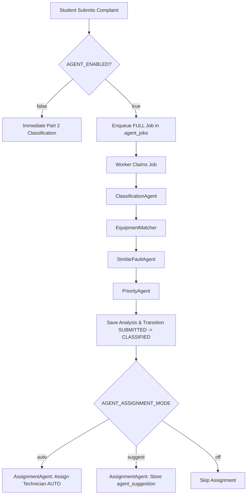

<!-- MODULE: Agentic Classification and Assignment (Module 2) - this file belongs to the code for this module. -->
# Agentic Complaint Classification and Assignment Architecture

## 1. Overview & System Purpose
Module 2 builds autonomous AI agent orchestration on top of Part 2 Complaint Management. When a student submits a verified complaint, specialized agents automatically classify the problem, match physical network hardware, find open clusters and historical resolutions, compute priority, and assign the ticket to the optimal technician while dispatching alerts.

## 2. Pipeline Execution Flow


## 3. Autonomous Agents
- **ClassificationAgent**: Reads sanitized comment and chat summary to produce problem category, confidence, priority hint, and 160-char summary. Retries once on JSON parse error before falling back to keyword rules.
- **EquipmentMatcher**: Matches location and category/room to active `IN_USE` switches and access points in `na_assets`.
- **SimilarFaultAgent**: Groups open cluster members, computes affected user impact, retrieves historical resolutions, and propagates priority upgrades to cluster members.
- **PriorityAgent**: Computes priority levels (`LOW`, `MEDIUM`, `HIGH`, `CRITICAL`) using a deterministic rule matrix.
- **AssignmentAgent**: Filters technicians by active status, `AVAILABLE` state, category coverage, and max open complaint limits. Evaluates candidate score (0-100) and executes `auto` assignment or `suggest` mode.

## 4. Priority Calculation Rules Matrix
| Base Input | Condition / Threshold | Impact | Max Cap |
|---|---|---|---|
| `priority_hint` | LOW=1, MEDIUM=2, HIGH=3, CRITICAL=4 | Base Level | CRITICAL (4) |
| `affected_users_count` | >= `AGENT_HIGH_IMPACT_USERS` (5) | +1 Level | CRITICAL (4) |
| `affected_users_count` | >= `AGENT_CRITICAL_IMPACT_USERS` (20) | Set CRITICAL (4) | CRITICAL (4) |
| Location | Listed in `AGENT_PRIORITY_LOCATIONS` | +1 Level | CRITICAL (4) |
| Recurrence | >= 2 complaints in last 7 days | +1 Level | CRITICAL (4) |

## 5. Candidate Assignment Weights
| Factor | Weight | Evaluation Formula |
|---|---|---|
| `ZONE_MATCH` | 35.0 | Technician profile includes complaint location zone |
| `WORKLOAD` | 25.0 | `25 * (1 - open_count / (max_open + 1))` |
| `EXPERIENCE` | 15.0 | `15 * min(closed_similar_90d, 5) / 5` |
| `CLUSTER` | 15.0 | Technician holds active open ticket in same cluster |
| `PERFORMANCE` | 10.0 | `10 * (rating_score / 5.0)` |

## 6. Execution Modes & Disabling
- `auto`: Agent automatically assigns best technician (`method="AUTO"`) and notifies technician with CC to Computer Centre In-charge.
- `suggest`: Agent computes candidate ranking, stores `agent_suggestion` on ticket, keeps status `CLASSIFIED`, and logs history NOTE. Manager confirms via Accept button (`AUTO_CONFIRMED`).
- `off`: Runs classification, fault cluster analysis, and priority estimation, but skips assignment.
- `AGENT_ENABLED=false`: Agentic pipeline bypassed entirely. Immediate Part 2 classification retains student selected category.

## 7. Failure Handling & Sweeps
- **Stuck Complaint Sweep**: Every 5 minutes, if a `SUBMITTED` complaint remains unprocessed > `AGENT_STUCK_MINUTES` (10) without a running job, worker advances it to `CLASSIFIED` using rules fallback and flags `agent_status=FAILED` for manager review.
- **Assignment Sweep**: Periodic sweep retries assignment for unassigned `CLASSIFIED` complaints ordered by priority (`CRITICAL` first) then oldest age. Triggered on technician availability toggle (`technician_availability_changed`) or reopened unassigned ticket.

## 8. Data Privacy Boundary
- **Never Sent to LLM**: Student full name, student email, mobile number, and room number.
- **Sent to LLM**: Selected problem type, location name, sanitized comment text, and sanitized AI chat summary.

## 9. Complaint Log Knowledge Base Ingestion
Upon ticket closure (`complaint_closed` event), eligible complaints (`closed_by="STUDENT"` with diagnosis/solution) are converted into anonymized `.txt` files (student name parts >=3 chars and room strings redacted to `[removed]`) and indexed into ChromaDB under category `complaint-logs` with `DocumentSourceType.COMPLAINT`.

## 10. Future Messaging Channel Extensibility (SMS / Telegram)
Alert objects are rendered channel-neutrally: `{title, body, priority, ticket_id, link, recipients}`. To add SMS or Telegram later, implement a channel listener in `notifications/service.py` consuming the alert payload without altering agent code.

## 11. Testing & Commands
```bash
# Run unit & agentic tests
PYTHONPATH=. python -m pytest backend/tests/test_agentic_module2.py backend/tests/test_unit.py -v

# Run E2E Smoke Test
PYTHONPATH=. python3 scripts/e2e_module2_smoke.py
```

## 12. Known Limitations
- LLM response latency depends on external provider API quota when mock provider is disabled.
- Switch port equipment mapping requires populated `na_locations` and `na_switch_ports` records.
