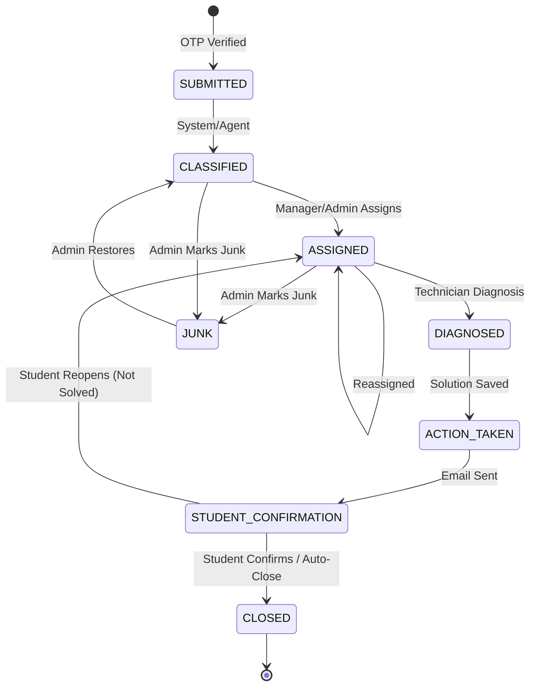

<!-- MODULE: Complaint Management (Part 2) - this file belongs to the code for this module. -->
<!-- Technical documentation for Complaint Management Module (Part 2). -->

# Complaint Management Guide (Part 2)

## 1. Module Overview
The **Complaint Management** module adds email-OTP complaint registration, staff role authentication (ADMIN, MANAGER, TECHNICIAN), complaint lifecycle transitions, technician dispatch & stock usage, student email notifications, confirmation/ratings, leaderboards, reports, and junk management.

---

## 2. Complaint Lifecycle (Mermaid Diagram)



---

## 3. Roles & Permissions Table

| Role | Complaint Management | Staff Management | Junk Management | Network Assets |
| :--- | :--- | :--- | :--- | :--- |
| **ADMIN** | Full Access (All views, assign, reports) | Full CRUD (Create, Reset Pwd, Deactivate) | Full Access (Mark, Restore, Clear All) | Full Write Access |
| **MANAGER** | All Complaints, Assign/Reassign, Tech Status, Reports, Leaderboard | None | None | Read-Only View |
| **TECHNICIAN**| Assigned Complaints, Resolve (Diagnosis/Solution/Stock), My Ratings | None | None | Read-Only View |

---

## 4. MongoDB Collections

- `staff_users`: Staff credentials (bcrypt), roles, technician profiles, zones, and notification toggles.
- `pending_complaints`: Unverified OTP complaint registrations (TTL index).
- `otp_request_log`: Per-email hourly OTP rate limit tracker (TTL 1h).
- `complaints`: Extended complaint documents with 12-digit `ticket_id`, status, items used, and Module 2 reserved fields.
- `complaint_history`: Append-only audit history log for status transitions and assignments.
- `ratings`: Student service ratings (1-5 stars) and feedback.
- `action_tokens`: SHA-256 hashed single-use student tokens (CONFIRM & RATE, TTL 14 days).
- `email_outbox`: Asynchronous email outbox queue for background SMTP worker.
- `admin_audit_log`: Administrative audit trail for staff changes and junk clearing.

---

## 5. API Reference

### Public Endpoints
- `GET /api/config` -> Returns locations, problem types, and allowed email domain (`allowed_email_domain`).
- `POST /api/complaints/otp/request` -> Submits complaint form & dispatches OTP.
- `POST /api/complaints/otp/verify` -> Verifies OTP & creates complaint ticket.
- `POST /api/complaints/otp/resend` -> Resends fresh OTP after 60s cooldown.
- `GET /api/student-actions/{token}` -> Public token details preview.
- `POST /api/student-actions/{token}/confirm` -> Confirms resolution or reopens complaint.
- `POST /api/student-actions/{token}/rate` -> Submits 1-5 star service rating.

### Auth & Staff Workspace Endpoints
- `POST /api/auth/login` -> Staff login returning Bearer JWT token.
- `GET /api/auth/me` -> Current staff user profile.
- `GET /api/manager/summary` -> Manager dashboard metrics.
- `GET /api/manager/complaints` -> Paginated complaint list with tab/search filters.
- `GET /api/manager/complaints/{ticket_id}` -> Full detail view with history timeline.
- `POST /api/manager/complaints/{ticket_id}/assign` -> Assigns complaint to technician.
- `GET /api/manager/technicians` -> Technicians availability & open complaint counts.
- `PATCH /api/manager/technicians/{id}/availability` -> Toggles technician availability.
- `GET /api/manager/reports` -> Analytics report (today, weekly, all-time).
- `GET /api/leaderboard` -> Active technician leaderboard ranks.
- `GET /api/technician/complaints` -> Assigned complaints for logged-in technician.
- `POST /api/technician/complaints/{ticket_id}/resolve` -> Submits resolution & stock usage.
- `GET /api/technician/my-ratings` -> Anonymous student ratings & position rank.
- `GET /api/admin/staff` & `POST /api/admin/staff` -> Admin staff CRUD.
- `POST /api/admin/complaints/{ticket_id}/mark-junk` & `POST /api/admin/complaints/{ticket_id}/restore` -> Junk management.
- `DELETE /api/admin/junk` -> Permanently purges junk complaints.

---

## 6. Email Event Triggers

| Event Key | Trigger | Recipient(s) |
| :--- | :--- | :--- |
| `complaint_registered` | OTP verified & ticket created | Student + Subscribed Admins |
| `complaint_assigned` | Manager assigns technician | Student + Assigned Tech (+ CC) |
| `complaint_reassigned` | Manager reassigns complaint | Student + New Tech + Old Tech |
| `complaint_solved` | Tech submits diagnosis & solution | Student (CONFIRM link) + Tech copy |
| `complaint_closed` | Student confirms or auto-closes | Student + Tech + RATE link |
| `rating_received` | Student submits 1-5 star rating | Assigned Technician |
| `complaint_reopened` | Student clicks 'Not Solved' | Student + Assigned Tech |

---

## 7. Module 2 Integration Hooks
- **Event Bus (`events.py`)**: Subscribes handlers to `complaint_registered`, `complaint_status_changed`, `complaint_assigned`, etc. Module 2 agents can subscribe to `complaint_registered` to run classification asynchronously.
- **Classification Hook (`classification_service.py`)**: `classify(complaint)` currently retains the student's selected problem type. Module 2 will replace its internal logic with LLM classification.
- **Single Transition Services (`status_service.py`, `assignment_service.py`)**: Centralized status and assignment transition entry points. Module 2 agents execute transitions with `actor_type="AGENT"`.

---

## 8. Database Scripts & Execution Order
Execute scripts from the repository root:

```bash
# 1. Create database collection indexes and TTL rules
PYTHONPATH=. python3 scripts_db/create_part2_indexes.py

# 2. Migrate existing Part 1 complaints (dry-run test first)
PYTHONPATH=. python3 scripts_db/migrate_complaints_part2.py --dry-run
PYTHONPATH=. python3 scripts_db/migrate_complaints_part2.py

# 3. Create initial ADMIN staff user
PYTHONPATH=. python3 scripts_db/create_admin.py admin "MNNIT Admin" admin@mnnit.ac.in "admin123"

# 4. (Optional) Seed Part 2 demo dataset
PYTHONPATH=. python3 scripts_db/seed_complaint_management_demo.py
```

---

## 9. Leaderboard Scoring Configuration
The scoring formula is selected in `.env`:
- `SCORE_FORMULA=average` -> Plain average rating score.
- `SCORE_FORMULA=weighted` -> Bayesian weighted average score `(prior_mean * prior_count + sum_of_ratings) / (prior_count + rating_count)` using `SCORE_PRIOR_MEAN=3.5` and `SCORE_PRIOR_COUNT=5`.
