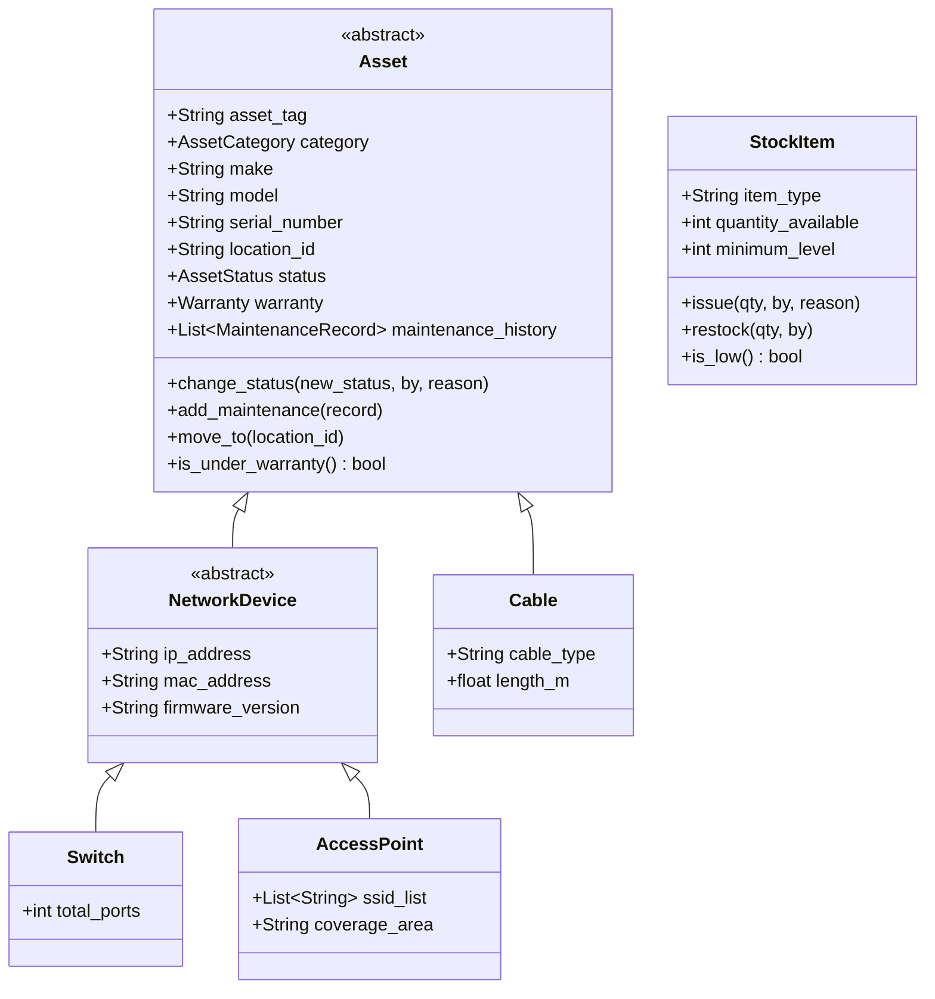

<!-- MODULE: Network Asset and Stock Management - this file belongs to the code for this module. -->
<!-- Technical documentation for the Network Asset and Stock Management module. -->

# Network Asset and Stock Management Module Guide

## 1. Module Overview
The **Network Asset and Stock Management** module is an isolated, admin-only management system integrated into the MNNIT Network Portal. It tracks physical hardware assets (switches, routers, access points, firewalls, cables, racks), campus location hierarchies, switch port serving mappings, and bulk stock inventory movements without interfering with complaints or chatbot operations.

---

## 2. Domain Class Hierarchy (Mermaid Diagram)



---

## 3. MongoDB Collections & Indexes

| Collection Name | Key Fields | Indexes Created |
| :--- | :--- | :--- |
| `na_assets` | `asset_tag`, `category`, `make`, `model`, `serial_number`, `location_id`, `status` | `serial_number` (unique), `asset_tag` (unique), `(category, status)`, `location_id` |
| `na_locations` | `name`, `code`, `type`, `parent_id` | `code` (unique), `parent_id` |
| `na_switch_ports` | `switch_id`, `port_number`, `status`, `vlan`, `location_id` | `(switch_id, port_number)` (unique) |
| `na_stock_items` | `item_type`, `make`, `model`, `quantity_available`, `minimum_level` | `item_type` |
| `na_stock_transactions`| `stock_item_id`, `change`, `reason`, `by`, `date` | `stock_item_id` |

---

## 4. Key Business Rules
1. **Uniqueness**: `serial_number` and `asset_tag` must be globally unique across all assets.
2. **Lifecycle Transitions**: `FAULTY`, `REPLACED`, or `RETIRED` assets cannot be moved directly to `IN_USE` without passing through `SPARE` or `UNDER_REPAIR` first. Status changes require a justification reason.
3. **Non-Empty Deletion Shield**: Locations containing active assets, child sub-locations, or mapped switch ports cannot be deleted.
4. **Automatic Retirement**: Assets with recorded maintenance/repair history are automatically marked `RETIRED` rather than hard deleted.
5. **Stock Bounds**: Bulk stock quantity cannot fall below zero.

---

## 5. API Reference & Sample Payloads

Base path: `/api/admin/network-assets` (Requires `Authorization: Bearer <token>`)

### 1. `POST /assets`
Creates a concrete asset subclass depending on `category`.
```json
{
  "asset_tag": "MNNIT-SW-004",
  "category": "SWITCH",
  "make": "Cisco",
  "model": "Catalyst 9300",
  "serial_number": "SN-SW-004",
  "location_id": "660c1a2b3c4d5e6f7a8b9c0d",
  "installation_date": "2026-03-31",
  "installed_by": "MNNIT Admin",
  "status": "SPARE",
  "total_ports": 24,
  "ip_address": "172.16.1.15"
}
```

### 2. `POST /stock/{id}/issue`
Issues bulk stock out of inventory and logs transaction.
```json
{
  "quantity": 2,
  "reason": "Deployed in Hostel Block A Room 214"
}
```

### 3. `GET /reports/summary`
Returns summary metrics card totals.
```json
{
  "total_assets": 12,
  "by_category": { "SWITCH": 3, "ACCESS_POINT": 2 },
  "by_status": { "IN_USE": 8, "SPARE": 3, "FAULTY": 1 },
  "spare_total": 3,
  "faulty_total": 1,
  "under_repair_total": 0,
  "low_stock_count": 1
}
```

---

## 6. Directory Map of Added Files

- **Backend**: `backend/app/network_assets/`
  - `models.py`, `factory.py`, `schemas.py`, `repository.py`, `services.py`, `router.py`
- **Frontend**:
  - `frontend/src/api/networkAssets.ts`
  - `frontend/src/components/network-assets/NetworkAssetsNav.tsx`
  - `frontend/src/pages/admin/network-assets/`: `Overview.tsx`, `AssetList.tsx`, `AssetForm.tsx`, `AssetDetail.tsx`, `Locations.tsx`, `SwitchPorts.tsx`, `Stock.tsx`
- **Scripts & Docs**:
  - `scripts_db/create_network_assets_indexes.py`
  - `scripts_db/seed_network_assets_demo.py`
  - `docs/NETWORK_ASSETS.md`
- **Tests**: `backend/tests/test_network_assets.py`

---

## 7. Execution Commands
- Create Indexes: `PYTHONPATH=. python3 scripts_db/create_network_assets_indexes.py`
- Seed Demo Data: `PYTHONPATH=. python3 scripts_db/seed_network_assets_demo.py`
- Run Tests: `PYTHONPATH=. pytest backend/tests/test_network_assets.py`
